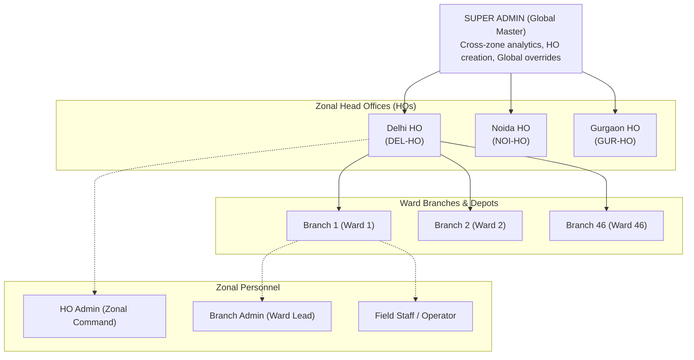
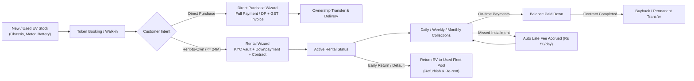
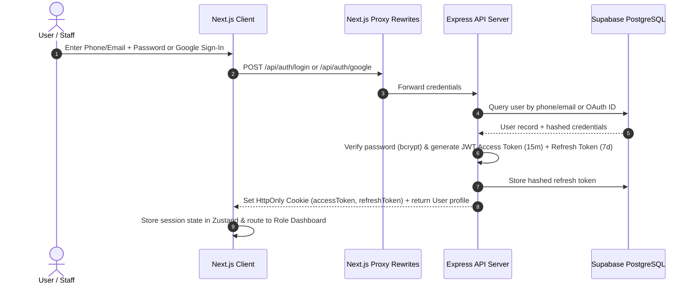
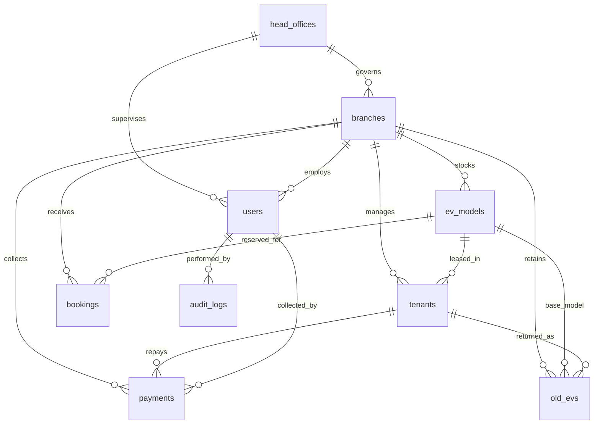

# Go Speedy EV Finance Scheme

<div align="center">

[](https://github.com)
[](https://nextjs.org/)
[](https://expressjs.com/)
[](https://supabase.com/)
[](https://tailwindcss.com/)
[](LICENSE)

<p align="center">
  <b>An enterprise-grade EV scooter rent-to-own, direct purchase, inventory, and financial ledger platform designed for large-scale electric fleet operations across Delhi NCR (Delhi, Noida, Gurgaon) and 46+ municipal wards.</b>
</p>

<p align="center">
  <a href="#executive-overview">Overview</a> &bull;
  <a href="#system-architecture--workflows">Architecture</a> &bull;
  <a href="#full-tech-stack-breakdown">Tech Stack</a> &bull;
  <a href="#security--enterprise-features">Key Features</a> &bull;
  <a href="#role-based-access-control-rbac-matrix">RBAC Matrix</a> &bull;
  <a href="#database-schema--relational-design">Database</a> &bull;
  <a href="#rest-api-reference">API Reference</a> &bull;
  <a href="#monorepo-project-structure">Structure</a> &bull;
  <a href="#quick-start--installation">Setup Guide</a>
</p>

</div>

---

## Executive Overview

**Go Speedy EV Finance Scheme** is a full-stack, multi-tenant fleet operations and financial management platform. It automates the complete operational lifecycle of electric two-wheelers: from ward-level inventory intake and token bookings to multi-step customer KYC onboarding, flexible rent-to-own agreements (up to 24 months), automated daily/weekly/monthly EMI calculations, late fee collections, AMC maintenance logs, battery and hardware serial tracking, and eventual ownership transfer or vehicle buyback.

The platform is designed around a **4-tier operational hierarchy** governing regional headquarters (Delhi Head Office, Noida Head Office, Gurgaon Head Office), dozens of ward branches, branch managers, and field staff.

---

## System Architecture & Workflows

### 1. Operational Hierarchy & Scoping Model



### 2. Fleet & Customer Lifecycle



### 3. Authentication & Session Flow



---

## Full Tech Stack Breakdown

### Frontend Architecture

| Category | Technology | Version | Purpose & Implementation Details |
| :--- | :--- | :--- | :--- |
| **Framework** | [Next.js](https://nextjs.org/) | `14.2.35` | React framework with App Router, server-side route proxy rewrites, and fast compilation. |
| **Core UI Library** | [React](https://react.dev/) / [React DOM](https://react.dev/) | `18.3.1` | Declarative component UI engine with modern hooks and concurrent rendering. |
| **Styling & CSS** | [Tailwind CSS](https://tailwindcss.com/) | `3.4.4` | Utility-first CSS framework with dynamic dark/light mode theming and custom extensions. |
| **CSS Processing** | [PostCSS](https://postcss.org/) / [Autoprefixer](https://github.com/postcss/autoprefixer) | `8.4.39` / `10.4.19` | Automated CSS prefixing, optimization, and Tailwind AST compilation. |
| **Animation Engine** | [GSAP](https://gsap.com/) & [@gsap/react](https://gsap.com/resources/React/) | `3.15.0` / `2.1.2` | High-performance animation engine used for KPI number tickers, fluid fade-ins, and hero transitions. |
| **3D & Shaders** | [OGL](https://github.com/oframe/ogl) | `1.0.11` | Minimal WebGL library powering interactive, responsive 3D fluid/metal canvas shaders on the landing page. |
| **Smooth Scrolling** | [Lenis](https://lenis.darkroom.engineering/) | `1.3.26` | Butter-smooth inertial scrolling physics across all dashboard interfaces. |
| **State Management** | [Zustand](https://github.com/pmndrs/zustand) | `4.5.4` | Lightweight, scalable state management for authentication, modals, branch switching, and UI state. |
| **Forms & Validation** | [React Hook Form](https://react-hook-form.com/) | `7.52.1` | High-speed, un-controlled form state manager minimizing unnecessary re-renders. |
| **Schema Validation** | [Zod](https://zod.dev/) & [@hookform/resolvers](https://github.com/react-hook-form/resolvers) | `3.23.8` / `3.9.0` | Strict schema validation sharing identical rules between frontend forms and backend controllers. |
| **Icons** | [Lucide React](https://lucide.dev/) | `0.400.0` | Clean, modern iconography system covering financial, vehicular, and administrative actions. |
| **HTTP Client** | [Axios](https://axios-http.com/) | `1.7.2` | Intercepted HTTP client handling automated token refreshes, queue retries, and `X-HTTP-Method-Override: PATCH`. |
| **Image Compression** | [browser-image-compression](https://github.com/Donaldcwl/browser-image-compression) | `2.0.2` | Client-side compression of customer KYC photos, PAN, Aadhaar, and vehicle images before upload. |
| **Report Exporting** | [XLSX (SheetJS)](https://sheetjs.com/) | `0.18.5` | Client-side generation and instant export of detailed Excel spreadsheets for fleet and collections audits. |

---

### Backend Architecture

| Category | Technology | Version | Purpose & Implementation Details |
| :--- | :--- | :--- | :--- |
| **Runtime Environment** | [Node.js](https://nodejs.org/) | `>= 18.x` | Cross-platform JavaScript runtime powering fast asynchronous I/O operations. |
| **Server Framework** | [Express.js](https://expressjs.com/) | `5.2.1` | RESTful API server structuring modular routes, middleware, and controllers. |
| **Database & ORM Client** | [@supabase/supabase-js](https://supabase.com/docs/reference/javascript/introduction) | `2.115.0` | Official client interacting with Supabase PostgreSQL via privileged Service Role Key. |
| **Database Engine** | [PostgreSQL](https://www.postgresql.org/) (Supabase) | `15+` | Relational database utilizing `pg_trgm` (trigram ILIKE search) and Row-Level Security (RLS). |
| **Object Storage** | [Supabase Storage](https://supabase.com/storage) | Built-in | Private storage buckets storing KYC, contracts, and insurance docs with pre-signed short-lived URLs. |
| **Authentication & Tokens**| [jsonwebtoken](https://github.com/auth0/node-jsonwebtoken) | `9.0.3` | Dual-token authentication issuing stateless 15-minute Access Tokens and verified payload claims. |
| **Password & Token Hash** | [bcryptjs](https://github.com/dcodeIO/bcrypt.js) | `3.0.3` | Multi-round salt hashing for user passwords and persistent database-stored refresh tokens. |
| **OAuth 2.0 Integration** | [Passport.js](https://www.passportjs.org/) / `passport-google-oauth20` | `0.7.0` / `2.0.0` | Google Single Sign-On (SSO) authentication for staff and administrative personnel. |
| **HTTP Security Headers** | [Helmet](https://helmetjs.github.io/) | `8.3.0` | Secures Express apps by setting essential HTTP headers, disabling iframe sniffing, and mitigating XSS. |
| **CORS Management** | [CORS](https://github.com/expressjs/cors) | `2.8.6` | Configurable origin whitelist ensuring cross-site requests are strictly guarded. |
| **Session Middleware** | [express-session](https://github.com/expressjs/session) | `1.19.0` | Ephemeral session state utilized exclusively during Google OAuth callback redirects. |
| **Cookie Parsing** | [cookie-parser](https://github.com/expressjs/cookie-parser) | `1.4.7` | Parses cryptographically secure, HttpOnly cookies containing authentication tokens. |
| **Rate Limiting** | [express-rate-limit](https://github.com/express-rate-limit/express-rate-limit) | `8.7.0` | Defense-in-depth against brute-force attacks and DDoS by throttling high-frequency API endpoints. |
| **File Upload Handling** | [Multer](https://github.com/expressjs/multer) | `2.3.0` | Multipart/form-data handler managing in-memory file buffers before passing to validation and Supabase. |
| **MIME/Magic Byte Check**| Custom `fileSignature.js` | Custom | Inspects raw magic numbers/file signatures to prevent malicious executable files posing as PDFs/images. |
| **Email & OTP Service** | [Nodemailer](https://nodemailer.com/) | `10.0.1` | SMTP transport integration for transactional password-reset OTP verification emails. |
| **Request Validation** | [Zod](https://zod.dev/) | `4.5.4` | Server-side runtime type checking and sanitization across all request bodies, params, and queries. |
| **API Documentation** | [swagger-ui-express](https://github.com/scottie1984/swagger-ui-express) / `swagger-jsdoc` | `5.0.1` / `6.3.0` | OpenAPI 3.0 interactive API documentation available in development environments. |
| **Unique ID Generator** | [uuid](https://github.com/uuidjs/uuid) | `14.0.2` | Generates cryptographically secure RFC4122 UUIDs for system entities. |

---

### Testing & Development Tooling

| Tool | Version | Role |
| :--- | :--- | :--- |
| **[Jest](https://jestjs.io/)** | `^30.5.1` | Automated test runner for unit testing authentication, balance math, JWTs, and multi-tenant scoping. |
| **[Supertest](https://github.com/ladjs/supertest)** | `^7.2.2` | HTTP assertions for testing REST endpoints and status codes without binding to physical network ports. |
| **[Nodemon](https://nodemon.io/)** | `^3.1.14` | Development auto-reload tool monitoring backend source changes. |
| **[Git](https://git-scm.com/)** | `2.x+` | Source control and monorepo versioning. |

---

## Security & Enterprise Features

### 1. 4-Tier Hierarchical Scoping & RBAC
Every operational user is bound to an administrative hierarchy:
- **`super_admin`**: Complete global oversight. Can create Head Offices, switch context between zones, inspect audit logs, and oversee all ward branches.
- **`ho_admin`**: Zonal Command. Bound strictly to their assigned `head_office_id` (e.g., Delhi HO). Manages ward branches and field staff in that region, monitoring zonal stock, collections, and delinquencies.
- **`branch_admin`**: Ward Depot Manager. Confined strictly to their ward branch (`branch_id`). Governs ward staff, bike assignments, and local cash handovers.
- **`staff`**: Field Operator. Handles daily walk-in collections, rental agreement paperwork, and EV return inspections.

### 2. Zero-Trust Document Vault
- Documents (Aadhaar Card, PAN Card, Cancelled Cheque, Electricity Bill, Rider License, Rent Agreements, Scooty/Rider Insurance) are stored in **private Supabase Storage buckets**.
- Files are never publicly accessible; downloads and previews rely on **cryptographically signed, short-lived URLs** (valid for minutes).
- Uploads undergo **magic-byte validation** (`fileSignature.js`) on the server to prevent disguised file execution.

### 3. Hardware Asset Uniqueness & Anti-Fraud
Electric scooters have critical hardware components recorded in the database with **partial unique indexes**:
- `chassis_no` (Unique across all active units)
- `motor_no` (Unique across all active units)
- `controller_no` (Unique across all active units)
- `charger_no` (Unique across all active units)
- `battery_no` (Unique across all active units)

Attempting to register or lease a duplicate battery or motor triggers a database-level rejection.

### 4. Precision Financial Ledger & Delinquency Engine
- Supports **Daily (Rs 250 default)**, **Weekly**, and **Monthly** installment cadences over a 24-month horizon.
- Dynamic **Balance & Overdue Calculator** calculates accrued vs. paid amounts, identifying delinquent contracts in real time.
- Automated daily late fee accumulation (`late_fee_daily_rate = 50.00/day`) with audit-logged penalty waiver support.
- Split-mode collection tracking (**Cash vs. Online / UPI**) with verified collector attribution.

### 5. Resilient Dual-Token Authentication
- **15-minute Access Tokens** (JWT) and **7-day Refresh Tokens** (hashed with `bcryptjs` in PostgreSQL).
- Refresh tokens are transmitted strictly via secure, `HttpOnly`, `SameSite=Lax` cookies to prevent XSS exfiltration.
- Automatic silent refresh queue handled transparently by the Axios client interceptor.

### 6. Comprehensive Audit Logging
- Every administrative action (staff creation, price updates, stock transfers, penalty waivers, contract modifications) writes an immutable record to `audit_logs` storing:
  - `user_id` and `user_role`
  - `action` (e.g., `CREATE_RENTAL`, `WAIVE_PENALTY`, `STOCK_ADJUST`)
  - `entity_type` and `entity_id`
  - `changes` (structured JSON before-and-after diff)
  - `ip_address` and timestamp

---

## Role-Based Access Control (RBAC) Matrix

| Module / Action | Super Admin | HO Admin | Branch Admin | Field Staff |
| :--- | :---: | :---: | :---: | :---: |
| **Manage Head Offices** | Full Access | Read Only | No Access | No Access |
| **Manage Ward Branches** | All Zones | Own Zone Only | View Own | View Own |
| **Create / Manage Staff** | All Roles | Branch Admin & Staff | View Own | No Access |
| **EV Models & Pricing** | Full Access | View Catalog | View Catalog | View Catalog |
| **Adjust Stock Count** | Full Access | Own Zone Branches | Own Ward Branch | No Access |
| **Used / Returned Fleet (`old_evs`)** | Full Access | Own Zone | Own Ward | View Available |
| **Register Rental / Purchase** | Full Access | Own Zone | Own Ward | Own Ward |
| **Collect Payments & EMIs** | Full Access | Own Zone | Own Ward | Own Ward |
| **Waive Delinquency Late Fees** | Full Access | With Audit Log | Restricted | Restricted |
| **Process EV Returns / Re-rent** | Full Access | Own Zone | Own Ward | Inspection Only |
| **Access System Audit Logs** | Global Logs | Zonal Logs | No Access | No Access |
| **Export Excel Reports** | Full Access | Zonal Reports | Ward Reports | No Access |

---

## Database Schema & Relational Design

The system runs on Supabase PostgreSQL with 9 core relational tables enforced with referential integrity, foreign key cascades, and check constraints:



### Table Breakdown

1. **`head_offices`**: Regional headquarters (`DEL-HO`, `NOI-HO`, `GUR-HO`) with city, state, and status.
2. **`branches`**: Physical ward branches (e.g., Delhi Wards 1 through 46) linked to a Head Office, with ward area, contact person, and address.
3. **`users`**: Administrative and operational personnel (`super_admin`, `ho_admin`, `branch_admin`, `staff`), hashed credentials, refresh tokens, and reset OTP hashes.
4. **`ev_models`**: Brand-new scooter specifications, ward attribution, base price, active stock count, and JSON stock adjustment history.
5. **`old_evs`**: Repossessed or returned scooters available for refurbished rental or resale, with individual component serial numbers and pricing.
6. **`tenants`**: Customer rental and direct purchase contracts, personal details, guarantor/reference JSON records, insurance policies, AMC records, hardware serials, and document vault paths.
7. **`payments`**: Transaction records with amount, mode (`cash` or `online`), late fees paid, penalty waiver flags, GST tax amount, and collector attribution.
8. **`bookings`**: Pre-booking customer token deposits, reservation status (`pending`, `converted`, `cancelled`), and target conversion type.
9. **`audit_logs`**: System-wide audit trail with user role, action type, affected entity, delta diffs (`JSONB`), and IP address.

---

## REST API Reference

The backend provides a modular RESTful API organized by domain. In local development environments, interactive OpenAPI documentation is accessible at `http://localhost:5000/api/docs`.

### Authentication & Account (`/api/auth`)
- `POST /api/auth/login` - Authenticate via phone/email and password; sets HttpOnly cookie tokens.
- `GET /api/auth/me` - Retrieve the current authenticated user profile and active permissions.
- `POST /api/auth/refresh` - Issue a new 15-minute access token using the rotating refresh token.
- `POST /api/auth/logout` - Revoke active refresh token and invalidate authentication cookies.
- `POST /api/auth/forgot-password` - Request a 6-digit OTP sent to registered email.
- `POST /api/auth/reset-password` - Verify OTP and set a new password.
- `GET /api/auth/google` - Initialize Google OAuth 2.0 single sign-on redirect.
- `GET /api/auth/google/callback` - Google OAuth callback handling and cookie exchange.

### Head Offices & Zonal Analytics (`/api/head-offices`)
- `GET /api/head-offices` - List all registered regional Head Offices.
- `GET /api/head-offices/my-dashboard` - Zonal intelligence dashboard for the authenticated HO Admin.
- `GET /api/head-offices/:id/dashboard` - Zonal intelligence for a specific HO (Super Admin only).
- `GET /api/head-offices/:id/branches` - List all ward branches belonging to a specific Head Office.
- `POST /api/head-offices` - Create a new regional Head Office (Super Admin only).

### Branches & Ward Management (`/api/branches`)
- `GET /api/branches` - List ward branches filtered by `head_office_id`, search term, or status.
- `GET /api/branches/:id` - Retrieve detailed branch profile including staff and fleet stats.
- `POST /api/branches` - Register a new ward branch (HO Admin or Super Admin).
- `PATCH /api/branches/:id` - Update branch details, contact info, or operational status.

### Staff & Personnel (`/api/staff`)
- `GET /api/staff` - List staff members scoped by user authority (Zonal or Branch level).
- `POST /api/staff` - Create new administrative or field personnel with role assignment.
- `PATCH /api/staff/:id` - Update staff profile, contact number, or assigned branch.
- `PATCH /api/staff/:id/status` - Activate or deactivate a staff member account.

### Fleet & EV Inventory (`/api/models` & `/api/old-evs`)
- `GET /api/models` - List EV models with live stock levels across ward depots.
- `POST /api/models` - Register a new EV model with initial pricing and specifications.
- `PATCH /api/models/:id/stock` - Adjust branch stock levels with mandatory audit reason.
- `GET /api/old-evs` - List refurbished and returned scooters available for rental or sale.
- `POST /api/old-evs` - Intake a returned scooter into the refurbished inventory pool.
- `PATCH /api/old-evs/:id` - Update condition, component serials, or resale status.

### Rentals & Leases (`/api/rentals`)
- `GET /api/rentals` - List rental contracts with status, overdue filters, and pagination.
- `GET /api/rentals/:id` - Detailed rental agreement, balance calculation, and payment history.
- `POST /api/rentals` - Register a new rental contract via the step-by-step onboarding wizard.
- `POST /api/rentals/:id/return` - Process scooter check-in and return to used fleet pool.

### Direct Purchases (`/api/purchases`)
- `GET /api/purchases` - List all completed and active direct purchase sales contracts.
- `GET /api/purchases/:id` - Retrieve direct sale details and printable invoice summary.
- `POST /api/purchases` - Register a direct purchase transaction with optional GST and downpayment.

### Token Bookings (`/api/bookings`)
- `GET /api/bookings` - List pre-bookings with status filters (`pending`, `converted`, `cancelled`).
- `POST /api/bookings` - Record customer token booking deposit for scooter reservation.
- `POST /api/bookings/:id/convert` - Convert booking deposit into an active rental or direct purchase.
- `PATCH /api/bookings/:id/cancel` - Cancel reservation with audit notes.

### Payments & Ledger (`/api/payments`)
- `GET /api/payments` - Query collection transactions by branch, date range, collector, or mode.
- `POST /api/payments` - Record an installment collection (Cash / Online) with automatic receipt generation.
- `POST /api/payments/waive-penalty` - Waive overdue late fees with required administrative justification.

### Secure Documents (`/api/documents`)
- `POST /api/documents/upload` - Upload KYC documents with magic-byte validation into Supabase Storage.
- `GET /api/documents/signed-url` - Generate a short-lived cryptographically signed viewing URL.

### Audit Trail (`/api/audit`)
- `GET /api/audit` - Query system audit logs with filters for actor, action type, and date range.

---

## Monorepo Project Structure

```text
Go Speedy Ev Finance Scheme/
├── backend/                              # Express RESTful API Server
│   ├── db/
│   │   └── schema.sql                    # Production PostgreSQL Schema & Zonal Seed Data
│   ├── src/
│   │   ├── config/
│   │   │   ├── cors.js                   # Cross-Origin Whitelist Policy
│   │   │   ├── env.js                    # Zod-validated Environment Schema
│   │   │   ├── passport.js               # Google OAuth 2.0 Passport Strategy
│   │   │   ├── supabase.js               # Supabase Client with Service Role Key
│   │   │   └── swagger.js                # OpenAPI 3.0 JSDoc Specifications
│   │   ├── middleware/
│   │   │   ├── auth.js                   # JWT Verification & Cookie Parser Middleware
│   │   │   ├── errorHandler.js           # Centralized API Error Response Formatter
│   │   │   ├── requestLogger.js          # Development HTTP Request Logger
│   │   │   ├── role.js                   # Role-Based Permission Guards
│   │   │   ├── roleGuard.js              # Multi-tier RBAC Validator
│   │   │   ├── scope.js                  # Multi-tenant HO & Branch Scoping Middleware
│   │   │   └── uploadHandler.js          # Multer Multipart Upload Handler
│   │   ├── modules/
│   │   │   ├── audit/                    # Audit Trail Logging Service & Controller
│   │   │   ├── auth/                     # Authentication, Refresh Tokens, & OTP
│   │   │   ├── bookings/                 # Pre-Booking Token Management
│   │   │   ├── branches/                 # Ward Branch Administration (46 Delhi Wards)
│   │   │   ├── documents/                # Signed Document Vault & Pre-signed URLs
│   │   │   ├── headOffices/              # Zonal Headquarters (Delhi, Noida, Gurgaon)
│   │   │   ├── models/                   # Brand-new & Refurbished EV Catalog
│   │   │   ├── payments/                 # Financial Ledger & Late Fee Engine
│   │   │   ├── purchases/                # Direct Purchase Flow & Invoicing
│   │   │   ├── rentals/                  # Rental Onboarding Wizard & Balance Engine
│   │   │   └── staff/                    # User Administration & Branch Assignment
│   │   ├── services/
│   │   │   └── email.service.js          # Email Transport for Transactional Emails
│   │   └── utils/
│   │       ├── auditLog.js               # Audit Event Logger Helper
│   │       ├── balanceCalc.js            # EMI & Late Fee Precision Math
│   │       ├── fileSignature.js          # Magic Byte File Header Security Inspector
│   │       ├── jwt.js                    # JWT Generation & Verification Utilities
│   │       ├── pagination.js             # Standardized Query Pagination Helper
│   │       └── response.js               # Uniform API Response Formatter
│   ├── tests/
│   │   └── unit/                         # Jest Unit Tests (Auth, Balance, JWT, Scoping)
│   ├── .env                              # Backend Environment Configuration
│   ├── index.js                          # Express Application Entry Point
│   └── package.json                      # Backend Dependencies & Scripts
│
├── frontend/                             # Next.js 14 Web Application
│   ├── public/                           # Static Web Assets, Branding, Favicons
│   ├── src/
│   │   ├── app/                          # Next.js App Router Structure
│   │   │   ├── (dashboard)/              # Authenticated Shell with Persistent Sidebar
│   │   │   │   ├── audit/                # Audit Trail Explorer
│   │   │   │   ├── bookings/             # Booking Tokens Management
│   │   │   │   ├── branches/             # Ward Branch Directory & Management
│   │   │   │   ├── dashboard/            # Dynamic Role-Based Command Centers
│   │   │   │   ├── models/               # EV Models Catalog & Stock Manager
│   │   │   │   ├── purchases/            # Direct Sales Directory & New Sale Wizard
│   │   │   │   ├── rentals/              # Rental Contracts & New Lease Wizard
│   │   │   │   └── staff/                # Staff & Personnel Management
│   │   │   ├── oauth-callback/           # OAuth Token Handshake Receiver
│   │   │   ├── globals.css               # Tailwind CSS Base & Theme Directives
│   │   │   ├── layout.js                 # Global Root HTML & Theme Wrapper
│   │   │   └── page.js                   # Landing Page (Interactive 3D Molten Metal Shader)
│   │   ├── components/
│   │   │   ├── branch/                   # BranchDashboard Components
│   │   │   ├── dashboard/                # Sustainability Metrics & Common Widgets
│   │   │   ├── ho/                       # HoDashboard Zonal Command Components
│   │   │   ├── layout/                   # Header, Sidebar, ProtectedRoute, BranchSwitcher
│   │   │   ├── staff/                    # StaffDashboard, QuickPaymentModal, ReturnEvModal
│   │   │   └── ui/                       # Design System Components (Card, Table, Badge, etc.)
│   │   ├── hooks/
│   │   │   └── useImageCompress.js       # Client-side Image Compression Hook
│   │   ├── lib/
│   │   │   ├── api.js                    # Axios Client with Auto-Refresh & Interceptors
│   │   │   ├── confirmDialog.js          # Imperative Modal Dialog Trigger
│   │   │   ├── constants.js              # System Roles, Status Codes, & Ward Maps
│   │   │   ├── exportToExcel.js          # SheetJS Excel Exporter Utility
│   │   │   ├── gsap.js                   # Reusable GSAP Animation Helper Routines
│   │   │   └── toast.js                  # Global Toast Notification Dispatcher
│   │   └── store/
│   │       ├── authStore.js              # Zustand Authentication & Permissions Store
│   │       ├── sidebarContext.js         # Responsive Sidebar Context
│   │       ├── themeContext.js           # Dark / Light Theme Toggle Context
│   │       └── uiStore.js                # Global UI & Modal State Store
│   ├── .env.local                        # Frontend Environment Configuration
│   ├── next.config.js                    # Next.js Proxy Rewrites & Route Configurations
│   ├── tailwind.config.js                # Tailwind CSS Configuration
│   └── package.json                      # Frontend Dependencies & Scripts
│
├── .gitignore                            # Git Exclusion Rules
└── README.md                             # Comprehensive Project Documentation
```

---

## Quick Start & Installation

### Prerequisites
- **Node.js**: `v18.x` or `v20.x` LTS
- **Package Manager**: `npm` (comes with Node.js) or `yarn` / `pnpm`
- **Database**: Active [Supabase](https://supabase.com) project with PostgreSQL and Storage enabled.

---

### Step 1: Database Initialization
1. Navigate to your Supabase project dashboard -> **SQL Editor**.
2. Open [`backend/db/schema.sql`](backend/db/schema.sql) from this repository.
3. Execute the SQL script. This sets up all tables, unique partial indexes, trigram search indices, and pre-seeds the 3 Head Offices (`DEL-HO`, `NOI-HO`, `GUR-HO`) and 46 Delhi municipal wards.
4. In Supabase **Storage**, create a private bucket named:
   ```text
   documents
   ```

---

### Step 2: Backend Setup
1. Open your terminal and navigate to the backend directory:
   ```bash
   cd backend
   ```
2. Install server dependencies:
   ```bash
   npm install
   ```
3. Create or update your backend `.env` configuration file:
   ```ini
   PORT=5000
   NODE_ENV=development
   FRONTEND_URL=http://localhost:3001
   BACKEND_URL=http://localhost:5000

   # Supabase Credentials
   SUPABASE_URL=https://your-project.supabase.co
   SUPABASE_SERVICE_ROLE_KEY=your-supabase-service-role-key

   # Security Secrets
   JWT_SECRET=super_strong_custom_jwt_secret_key_32_chars_min
   SESSION_SECRET=session_secret_for_oauth

   # Swagger Documentation (true for development)
   SWAGGER_ENABLED=true

   # Google OAuth (Optional - Cloud Console)
   GOOGLE_CLIENT_ID=your-google-client-id
   GOOGLE_CLIENT_SECRET=your-google-client-secret
   GOOGLE_CALLBACK_URL=http://localhost:5000/api/auth/google/callback
   ```
4. Start the backend development server:
   ```bash
   npm run dev
   ```
   *The server starts on `http://localhost:5000` with hot-reloading via Nodemon.*

---

### Step 3: Frontend Setup
1. In a new terminal window, navigate to the frontend directory:
   ```bash
   cd frontend
   ```
2. Install client dependencies:
   ```bash
   npm install
   ```
3. Create or update `frontend/.env.local` to point to your backend API:
   ```ini
   NEXT_PUBLIC_API_URL=http://localhost:5000
   ```
4. Start the Next.js development server:
   ```bash
   npm run dev
   ```
   *The frontend starts on `http://localhost:3001`.*

---

### Step 4: Accessing the Application
- **Frontend Web App**: `http://localhost:3001`
- **Backend REST API**: `http://localhost:5000`
- **Interactive Swagger Docs**: `http://localhost:5000/api/docs` *(available in development mode)*
- **Health Check Endpoint**: `http://localhost:5000/health`

---

## Testing & Quality Assurance

### Running Backend Unit Tests
The backend includes a comprehensive Jest test suite verifying token refreshes, EMI balance calculations, JWT handling, and multi-tenant scoping guards.

```bash
cd backend

# Run all unit tests
npm run test:unit

# Run full test suite with coverage
npm test
```

### Running Frontend Linter
```bash
cd frontend
npm run lint
```

---

## Environment Variables Reference

### Backend (`/backend/.env`)

| Variable Name | Required | Default | Description |
| :--- | :---: | :---: | :--- |
| `PORT` | Optional | `5000` | Port on which the Express server listens. |
| `NODE_ENV` | Optional | `development` | Environment mode (`development`, `production`, `test`). |
| `FRONTEND_URL` | Yes | `http://localhost:3001` | Origin URL permitted by CORS policy to receive credentials. |
| `BACKEND_URL` | Optional | `http://localhost:5000` | Fully qualified backend URL for OAuth callback redirects. |
| `SUPABASE_URL` | **Yes** | - | Supabase PostgreSQL project URL. |
| `SUPABASE_SERVICE_ROLE_KEY` | **Yes** | - | Privileged Supabase Service Role Key for server-side queries. |
| `JWT_SECRET` | **Yes** | - | Cryptographic secret used to sign 15-minute access tokens. |
| `SESSION_SECRET` | Optional | - | Ephemeral secret key for temporary OAuth sessions. |
| `SWAGGER_ENABLED` | Optional | `true` | Enables Swagger UI documentation at `/api/docs` in non-production. |
| `GOOGLE_CLIENT_ID` | Optional | - | OAuth client ID obtained from Google Cloud Console. |
| `GOOGLE_CLIENT_SECRET` | Optional | - | OAuth client secret obtained from Google Cloud Console. |
| `GOOGLE_CALLBACK_URL` | Optional | - | OAuth callback URL matching the Google Cloud configuration. |

### Frontend (`/frontend/.env.local`)

| Variable Name | Required | Default | Description |
| :--- | :---: | :---: | :--- |
| `NEXT_PUBLIC_API_URL` | Optional | `http://localhost:5000` | Base destination for Next.js internal proxy rewrites (`/api/*`). |

---

## Production Deployment Considerations

1. **Proxy Trust**: The Express server is pre-configured with `app.set('trust proxy', 1)` to correctly inspect secure headers when deployed behind reverse proxies like Vercel, Railway, or AWS ALB.
2. **Next.js Proxy Rewrites**: In production, Next.js rewrites route all client-side `/api/*` traffic to the backend, preventing cross-site cookie blocking and eliminating CORS configuration issues.
3. **HTTP Method Override**: Some proxy layers strip request bodies from `PATCH` calls. The client transparently transforms `PATCH` into `PUT` with `X-HTTP-Method-Override: PATCH`, which the backend middleware reverts before hitting controllers.
4. **Swagger In Production**: Swagger UI is automatically restricted to development environments to ensure zero endpoint enumeration surface in live production.

---

## License

This project is licensed under the [MIT License](LICENSE).

---

<div align="center">
  <sub>Built for accelerating sustainable electric mobility across Delhi NCR.</sub>
</div>
