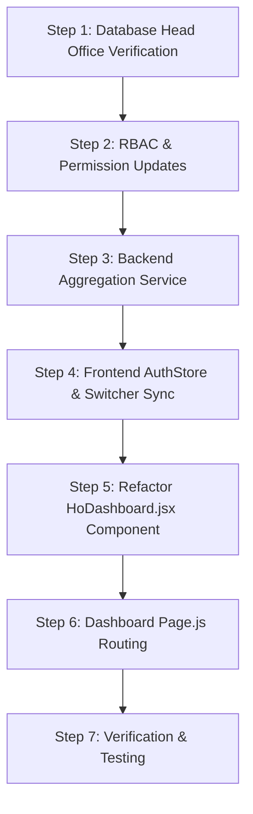

# Go Speedy EV — Head Office (HO) Implementation Plan

> **Document:** `plan.md`  
> **Target Module:** Head Office (HO) Command System & HO Dashboard  
> **Scope:** Architecture, Database Alignment, Backend APIs, Security & Permissions, and Pixel-Perfect Frontend UI matching the existing design system.

---

## 1. Executive Summary & System Objectives

The Go Speedy EV platform operates on a 4-tier operational hierarchy:
```
                 SUPER ADMIN (Global Master)
                             │
       ┌─────────────────────┼─────────────────────┐
       ▼                     ▼                     ▼
   DELHI HO              NOIDA HO             GURGAON HO    ◄── [HEAD OFFICE SCOPE]
       │                     │                     │
    Branches              Branches              Branches
  (e.g. Wards 1–46)     (e.g. Sec 1–62)       (e.g. DLF, Cyber)
       │                     │                     │
  Branch Admins         Branch Admins         Branch Admins
       │                     │                     │
     Staff                 Staff                 Staff
       │                     │                     │
   Customers             Customers             Customers
       ▼                     ▼                     ▼
  Bikes ──► Sale/Rental ──► Payments ──► EMI ──► Overdue/Late Fee ──► Reports
```

### Purpose of the HO System
The **Head Office (HO) Dashboard** is the **Zonal Command Center**. It aggregates live operational and financial intelligence across all branches governed by a specific Head Office (e.g., Delhi HO, Noida HO, or Gurgaon HO).

### Core HO Admin Responsibilities (per specification)
1. **Manage Branches:** Create, view, and monitor all branches/wards within their assigned Head Office.
2. **Manage Branch Admins & Staff:** Create and assign Branch Admins and field operators to branches under their HO.
3. **Monitor Fleet & Stock:** Track available EV inventory, depleted-stock wards, and new vs. used EV distribution.
4. **Monitor Sales & Rentals:** Track active rental contracts, direct sales, and pending bookings across the zone.
5. **Monitor Collections & Outstanding:** Track daily and cumulative cash/online collections, live outstanding debt, overdue aging, and late fees.
6. **Branch Performance Matrix:** Rank and compare branch collection efficiency, default rates, and stock health.

---

## 2. Architecture & Data Scoping Rules

### Scoping Matrix

| Role | Head Office Scope | Branch Scope | Dashboard Shown |
| :--- | :--- | :--- | :--- |
| **Super Admin** | Can switch between **All HOs (Global)**, **Delhi HO**, **Noida HO**, or **Gurgaon HO**. | Can switch to any branch globally. | `AdminDashboard` with HO selector toggle OR full `HoDashboard` for selected HO. |
| **HO Admin** | **Strictly locked** to their assigned `head_office_id`. Cannot access records of other HOs. | Can view aggregate zone data OR filter by any branch under their HO. | `HoDashboard` (Dynamic to their assigned HO). |
| **Branch Admin** | Inherits their branch's `head_office_id`. | Strictly locked to their assigned `branch_id`. | `BranchDashboard`. |
| **Staff** | Inherits branch's `head_office_id`. | Strictly locked to their assigned `branch_id`. | `StaffDashboard`. |

---

## 3. Database & Seeding Plan

### 3.1 Pre-seeded Head Offices
Ensure `head_offices` table has the three regional zonal headquarters:

```sql
INSERT INTO head_offices (id, name, code, city, state, is_active)
VALUES
  ('a0000000-0000-0000-0000-000000000001', 'Delhi Head Office', 'DEL-HO', 'New Delhi', 'Delhi NCT', true),
  ('a0000000-0000-0000-0000-000000000002', 'Noida Head Office', 'NOI-HO', 'Noida', 'Uttar Pradesh', true),
  ('a0000000-0000-0000-0000-000000000003', 'Gurgaon Head Office', 'GUR-HO', 'Gurgaon', 'Haryana', true)
ON CONFLICT (code) DO UPDATE 
SET name = EXCLUDED.name, city = EXCLUDED.city, state = EXCLUDED.state;
```

### 3.2 Branch Attribution
Every branch must reference its governing Head Office:
* All 46 Delhi Wards $\rightarrow$ `head_office_id = 'a0000000-0000-0000-0000-000000000001'` (DEL-HO).
* Noida Branches $\rightarrow$ `head_office_id = 'a0000000-0000-0000-0000-000000000002'` (NOI-HO).
* Gurgaon Branches $\rightarrow$ `head_office_id = 'a0000000-0000-0000-0000-000000000003'` (GUR-HO).

### 3.3 User Role & HO Association
HO Admin users in `users` table:
* `role = 'ho_admin'`
* `head_office_id = <target_ho_uuid>`
* `branch_id = NULL` (HO Admins govern all branches in their zone, not a single branch).

---

## 4. Backend API & Service Specifications

### 4.1 Fix RBAC Guards in Existing Routes
1. **`backend/src/modules/staff/staff.routes.js`**:
   * **Problem:** Currently uses `requireAdmin` (`super_admin` only), blocking HO Admins from managing staff.
   * **Fix:** Change to `requireRole('super_admin', 'ho_admin', 'admin')`.
2. **`backend/src/modules/staff/staff.service.js`**:
   * For `ho_admin`, restrict staff listing and creation strictly to:
     * `head_office_id = req.user.head_office_id`
     * Allowed roles to create: `branch_admin` and `staff` (cannot create `super_admin` or `ho_admin`).
3. **`backend/src/modules/branches/branches.routes.js`**:
   * Allow `ho_admin` to create and update branches under their own `head_office_id`.

### 4.2 Real Data Aggregation for HO Dashboard (`headOffices.service.js`)
Replace the current simulated math (`wardStock = wardNum <= 10 ? 8 : ...`) with **real live database aggregations**:

#### Endpoint: `GET /api/head-offices/my-dashboard` (and `GET /api/head-offices/:id/dashboard`)
**Query Execution Plan:**
1. **Head Office Profile:**
   * Fetch `head_offices` row by resolved `hoId` (`req.user.head_office_id` or query param for Super Admin).
2. **Zonal Branches:**
   * Query `branches` where `head_office_id = hoId` and `is_active = true`.
   * Extract list of `branchIds`.
3. **Zonal Inventory Calculation:**
   * Query `ev_models` associated with this HO / these branches.
   * Query `old_evs` where `head_office_id = hoId` or `branch_id IN (branchIds)` and `status = 'available'`.
   * Calculate:
     * `totalStock`: Sum of available brand-new EVs + available used EVs.
     * `zeroStockBranchCount`: Number of branches where stock equals 0.
4. **Zonal Rentals & Outstanding:**
   * Query `tenants` where `branch_id IN (branchIds)` or `head_office_id = hoId`.
   * Compute for each tenant using `calcBalance`:
     * Active Rentals count (`status = 'rented'`).
     * Direct Purchases / Completed count (`status IN ('completed', 'direct_purchase')`).
     * `totalOutstanding`: Sum of remaining installment debt.
     * `overdueCount`: Number of tenants where `daysOverdue > 0`.
     * `totalLateFeeAccrued`: Sum of `daysOverdue * late_fee_daily_rate`.
5. **Zonal Revenue & Collections:**
   * Query `payments` where `branch_id IN (branchIds)` or `head_office_id = hoId`.
   * Calculate:
     * `todayCollections`: Sum of amount where `payment_date = CURRENT_DATE`.
     * `totalCollections`: All-time sum of payments collected.
     * `modeBreakdown`: Total cash vs. total online collections.
6. **Branch Performance Matrix (Table Data):**
   * Map every branch in `branches` to:
     * `id`, `name`, `code`, `ward_no`, `ward_area`, `address`
     * `branch_admin`: Name & phone from `users` where `branch_id = branch.id` and `role = 'branch_admin'`.
     * `stock_count`: Live available stock in this branch.
     * `active_rentals`: Live rented scooters in this branch.
     * `overdue_count`: Live delinquent accounts in this branch.
     * `total_collected`: Cumulative revenue collected in this branch.
7. **Zonal Overdue Watchlist (Real Delinquency List):**
   * Query top 6 overdue tenants in the zone sorted by `daysOverdue DESC`:
     * Tenant name, phone, EV model name, branch name & ward number, days overdue, and outstanding amount.

---

## 5. Frontend UI/UX Architecture (Matching Current Design System)

The HO Dashboard will strictly use the project's established styling:
* **Backgrounds:** `bg-slate-50 dark:bg-slate-950` with `transition-colors`.
* **Cards & Containers:** `rounded-2xl border border-slate-200/80 dark:border-white/10 bg-white dark:bg-slate-900/80 p-5 sm:p-6 shadow-xs`.
* **Typography:** Modern font hierarchy, `font-black` headings, uppercase tracking-wider subtitles (`text-[11px] font-bold uppercase tracking-wider text-slate-500 dark:text-slate-400`).
* **Animations:** GSAP `animateCounter` for KPI numbers, `staggerFadeIn` for entry animations.
* **Component Library:** Built-in `Card`, `Badge`, `Button`, `Spinner`, `Table`, `Modal`, `BrandLogo`.

```
┌────────────────────────────────────────────────────────────────────────────────────────┐
│ SECTION 1: DYNAMIC ZONAL HERO BANNER                                                   │
│ • Badge: "HEAD OFFICE JURISDICTION: DEL-HO / NOI-HO / GUR-HO"                          │
│ • Title: "{Head Office Name}" (e.g. Delhi Head Office / Noida Head Office)              │
│ • Subtitle: "Governing {totalBranches} Branches across {City} • Zonal Fleet Command"    │
│ • Action Button: "[Manage {totalBranches} Branches ->]"                                │
├────────────────────────────────────────────────────────────────────────────────────────┤
│ SECTION 2: 5 CORE EXECUTIVE ZONAL KPIS (With GSAP Smooth Counters)                     │
│ ┌──────────────┐ ┌──────────────┐ ┌──────────────┐ ┌──────────────┐ ┌────────────────┐ │
│ │  ZONAL FLEET │ │ACTIVE RENTALS│ │TERRITORY LAG │ │  COLLECTIONS │ │GOVERNED BRANCHS│ │
│ │    184 EVs   │ │    142 Live  │ │   8 Overdue  │ │  ₹14,85,200  │ │   46 Branches  │ │
│ │ (Blue Icon)  │ │(Emerald Icon)│ │ (Rose Icon)  │ │(Indigo Icon) │ │  (Cyan Icon)   │ │
│ └──────────────┘ └──────────────┘ └──────────────┘ └──────────────┘ └────────────────┘ │
├────────────────────────────────────────────────────────────────────────────────────────┤
│ SECTION 3: INVENTORY HEALTH ALERT (Conditional Banner)                                 │
│ [!] "Stock Alert: 3 Branches currently have 0 available EV stock. Replenish now."      │
│     Button: "[Filter Zero-Stock Branches]"                                             │
├────────────────────────────────────────────────────────────────────────────────────────┤
│ SECTION 4: BRANCH PERFORMANCE MATRIX (Interactive Table)                              │
│ Search input | Status filter pills: [All] [Overdue Alert] [Zero Stock]                 │
│ Columns:                                                                               │
│ • Branch & Code (Ward #, Name, Location)                                               │
│ • Branch Admin (Name, Phone, Direct Call Link, or 'Vacant' Badge)                      │
│ • Stock Level (Badge: Emerald >3, Amber 1-3, Rose 0)                                   │
│ • Active Rentals Count                                                                 │
│ • Overdue Cases (Rose Alert Pill or '—')                                               │
│ • Collections (₹ Currency formatted)                                                   │
│ • Action: "[Filter / Drill Down ->]" (Switches view to this branch)                    │
├────────────────────────────────────────────────────┬───────────────────────────────────┤
│ SECTION 5: LIVE ZONAL OVERDUE WATCHLIST            │ SECTION 6: ZONAL REVENUE & SPLIT  │
│ Top 6 Delinquent Accounts across all branches:     │ • Today's Collections: ₹38,500    │
│ • Tenant Name & Phone                              │ • Month-to-Date: ₹4,12,000        │
│ • Scooter Model & Branch Name                      │ • Payment Mode Distribution:      │
│ • Days Overdue (e.g. "5 Days Overdue")             │   - Online: 68% (Blue Bar)        │
│ • Total Outstanding (₹)                            │   - Cash: 32% (Emerald Bar)       │
│ • Quick Action: [Call Tenant]                      │ • Outstanding Recoverable: ₹12.4L │
├────────────────────────────────────────────────────┴───────────────────────────────────┤
│ SECTION 7: HO COMMAND SHORTCUTS                                                        │
│ 4 Clickable Action Tiles:                                                              │
│ [Branch Registry]  [Staff & Branch Admins]  [Fleet & Models]  [Revenue & Ledger]       │
└────────────────────────────────────────────────────────────────────────────────────────┘
```

---

## 6. Detailed Frontend Implementation Plan

### 6.1 Routing in `frontend/src/app/(dashboard)/dashboard/page.js`
Update the role-based dashboard view switcher:
```javascript
export default function DashboardPage() {
  const { role } = useAuthStore();
  const isSuperAdmin = role === 'super_admin' || role === 'admin';

  return (
    <div className="flex-1 flex flex-col">
      {role === 'staff' ? (
        <StaffDashboard />
      ) : role === 'branch_admin' ? (
        <BranchDashboard />
      ) : role === 'ho_admin' ? (
        <HoDashboard />
      ) : (
        <AdminDashboard />
      )}
      {isSuperAdmin && <DashboardFooter />}
    </div>
  );
}
```

### 6.2 Refactoring `frontend/src/components/ho/HoDashboard.jsx`
1. **Dynamic Text & Data Bindings:**
   * Replace all hardcoded "Delhi Head Office" and "46 Wards" strings with `data.headOffice.name`, `data.headOffice.city`, and `data.summary.totalWards`.
2. **Real Overdue Watchlist Rendering:**
   * Replace the static HTML items (`W2: Saroop Nagar`, `W9: Punjabi Bagh`, `W16: Tagore Garden`) with a dynamic map over `data.recentOverdue` or `data.overdueTenants`.
3. **Branch Performance Matrix Enhancement:**
   * Display the assigned Branch Admin's name and phone number on each row.
   * If no Branch Admin is assigned, display a clean Amber badge: `"Vacant - Needs Admin"`.
4. **Interactive Branch Drill-down:**
   * Clicking "Filter / Drill Down" on a branch calls `setSelectedBranch(branch)` and navigates to the detailed branch perspective.
5. **GSAP Counter Animations:**
   * Smoothly count up `totalStock`, `activeRentals`, `overdueCount`, `totalCollections`, and `totalWards` on initial page load.

### 6.3 State Management & Switcher (`authStore.js` & `BranchSwitcher.jsx`)
1. **In `authStore.js`:**
   * Allow `ho_admin` to execute `setSelectedBranch`:
     ```javascript
     setSelectedBranch: (branch) => {
       const state = get();
       const canSwitch = isMasterSuperAdmin(state.user) || state.user?.role === 'ho_admin';
       if (!canSwitch) return;
       // sets branch and dispatches branchChange event
     }
     ```
   * Add support for `selectedHeadOffice` for Super Admins.
2. **In `BranchSwitcher.jsx`:**
   * For `ho_admin`, filter the branch dropdown strictly to branches where `head_office_id === user.head_office_id`.
   * For `super_admin`, group branches cleanly by Head Office (`Delhi HO`, `Noida HO`, `Gurgaon HO`) with a "Switch Head Office" section.

### 6.4 Sidebar Links (`Sidebar.jsx`)
For `ho_admin`, ensure navigation displays:
* **Zonal Command Desk** (`/dashboard`)
* **Governed Branches** (`/branches`)
* **Branch Admins & Staff** (`/staff`)
* **EV Fleet & Models** (`/models`)
* **Rentals & Contracts** (`/rentals`)
* **Ledger & Collections** (`/purchases`)
* **Walk-in Bookings** (`/bookings`)

---

## 7. Step-by-Step Implementation Sequence



### Step 1: Database Head Office Verification
* Confirm the 3 Head Offices (`DEL-HO`, `NOI-HO`, `GUR-HO`) exist in the database with correct UUIDs.
* Ensure all existing branches are correctly mapped to their respective `head_office_id`.

### Step 2: RBAC & Permission Updates
* In `backend/src/middleware/roleGuard.js`: Ensure `requireHoAdmin` allows `['super_admin', 'ho_admin', 'admin']`.
* In `backend/src/modules/staff/staff.routes.js`: Update route guards so `ho_admin` can view, create, and update staff in their zone.
* In `backend/src/modules/staff/staff.service.js`: Apply scoping so `ho_admin` only manages users with matching `head_office_id`.

### Step 3: Backend Aggregation Service (`headOffices.service.js`)
* Rewrite `getHeadOfficeDashboard(headOfficeId, user)`:
  * Remove simulated equations.
  * Query live count of available brand-new and old EVs.
  * Query live tenants, calculate actual overdue count and delinquent debt.
  * Query live payments for today's collection, MTD, and all-time revenue.
  * Return actual top overdue tenants for the zonal watchlist.

### Step 4: Frontend AuthStore & Switcher Sync
* In `frontend/src/store/authStore.js`: Permit `ho_admin` to select and switch between branches within their HO.
* In `frontend/src/components/layout/BranchSwitcher.jsx`: Filter branch list for `ho_admin` to only their assigned HO.

### Step 5: Refactor `HoDashboard.jsx` Component
* Make all typography and banners dynamic to the loaded HO.
* Replace static overdue cards with live backend data.
* Ensure table columns show Branch Admin contact info and stock badges.
* Add payment mode split (Cash vs. Online progress bar).
* Wire up drill-down buttons.

### Step 6: Dashboard `page.js` Routing
* In `frontend/src/app/(dashboard)/dashboard/page.js`: Add conditional branch:
  ```javascript
  else if (role === 'ho_admin') {
    return <HoDashboard />;
  }
  ```

### Step 7: Verification & Testing
* Log in as Super Admin $\rightarrow$ Verify switching between Delhi HO, Noida HO, and Gurgaon HO.
* Log in as Delhi HO Admin $\rightarrow$ Verify only Delhi branches, stock, and collections appear.
* Log in as Noida HO Admin $\rightarrow$ Verify only Noida data appears.
* Test Branch Admin creation by HO Admin $\rightarrow$ Ensure they can create branch managers.
* Verify responsive design and dark/light mode toggle.

---

## 8. Verification & Acceptance Criteria

1. **Dashboard Route Test:** When an `ho_admin` logs in, they land directly on `<HoDashboard />` (not `<AdminDashboard />`).
2. **Dynamic Jurisdiction:** When viewing Noida HO, the banner displays "Noida Head Office", "NOI-HO", and the correct number of Noida branches.
3. **Real Stock Numbers:** Inventory cards accurately reflect actual available models + available old EVs in that HO.
4. **Real Overdue List:** The Overdue & Recovery Watchlist renders actual delinquent tenants from the database with real phone numbers and overdue day counts.
5. **Staff Management Access:** An HO Admin can open `/staff`, create a new `Branch Admin`, and assign them to a branch under their HO without receiving a 403 Forbidden error.
6. **Zero-Stock Warning:** If any branch in the HO has 0 available EVs, the amber alert banner appears with a direct filter button.
7. **Visual Polish:** Fully compliant with existing Tailwind styles, dark mode, GSAP counter animations, and Lucide icon conventions.
